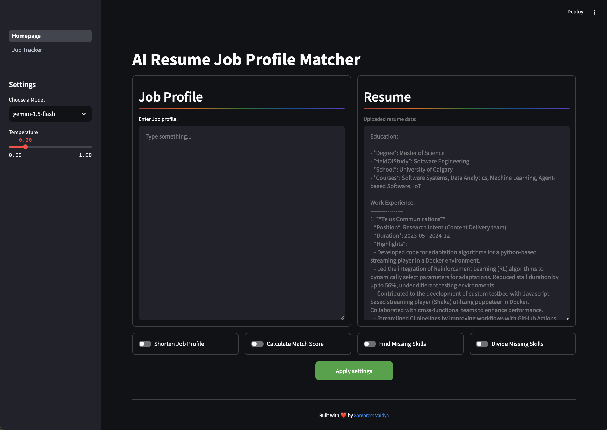

# AI Resume & Job Profile Matcher

[](https://www.python.org/)
[](https://streamlit.io/)
[](https://aistudio.google.com/)
[](https://ollama.com/)
[](LICENSE)

An intelligent career assistant and recruitment analysis tool powered by **Google Gemini** and **Local Ollama LLMs** (Llama 3.2, Mistral, Phi-3). It bridges the gap between candidate resumes and modern job postings by automating job description analysis, calculating weighted compatibility scores, identifying granular skill gaps across technical and soft skill domains, and tracking application workflows.

---

## Table of Contents

- [Overview](#overview)
- [Key Features](#key-features)
- [Application Preview](#application-preview)
- [Project Architecture](#project-architecture)
- [Getting Started](#getting-started)
  - [Prerequisites](#prerequisites)
  - [Installation](#installation)
  - [API Key Configuration](#api-key-configuration)
  - [Customizing Your Resume](#customizing-your-resume)
  - [Running the App](#running-the-app)
- [Configuration](#configuration)
- [Job Tracker](#job-tracker)
- [Roadmap](#roadmap)
- [Contributing](#contributing)
- [License](#license)
- [Contact](#contact)

---

## Overview

Applying for jobs in tech and data domains often requires tailoring resumes to match applicant tracking systems (ATS) and specific job descriptions. The **AI Resume & Job Profile Matcher** automates this process:

1. **Loads Candidate Data**: Reads structured profile data (education, work experience, accomplishments, technical skills) from a structured JSON schema.
2. **Evaluates Job Postings**: Uses Google Gemini models to extract key competencies and compare them against candidate qualifications.
3. **Pinpoints Skill Gaps**: Categorizes missing skills into targeted technical and soft skill categories, and further divides them into career paths (Software Engineering, Data Science / ML, Data Analytics).
4. **Tracks Job Applications**: Provides an interactive, persistent dashboard to track companies, application dates, optimization status, outreach, and interview stages.

---

## Key Features

- **Job Description Summarization**: Automatically extracts core qualifications, experience requirements, education, and specific prerequisites from verbose job descriptions.
- **Weighted Match Scoring (0–100%)**: Evaluates compatibility based on customizable weighted criteria:
  - Skills: **40%**
  - Experience: **30%**
  - Education: **20%**
  - Certifications: **10%**
  - Includes visual color-coded progress bars (Green $\ge$ 70%, Orange $\ge$ 40%, Red < 40%).
- **Categorized Skill Gap Analysis**: Pinpoints qualifications present in the job posting but missing from your profile across 5 distinct categories:
  - *Programming Languages*
  - *Tools*
  - *Libraries & Frameworks*
  - *Soft Skills*
  - *Miscellaneous*
- **Role-Based Skill Division**: Groups missing technical skills into targeted career tracks:
  - *Software Developer*
  - *ML Engineer / Data Scientist*
  - *Data Analyst*
- **Interactive Job Application Tracker**: Built-in multi-page Streamlit tracker with editable tables, dynamic row additions, date pickers, tracking checkboxes (Applied, Resume Optimized, LinkedIn Outreach, Cold Email, Selected), status dropdowns (Applied, Interview, Offer, Rejected), and direct CSV persistence.
- **Configurable LLM Runtime**: Choose between multiple Gemini models (`gemini-1.5-flash`, `gemini-1.5-pro`, `gemini-2.0-flash-exp`, `gemini-1.5-flash-8b`) and adjust generation temperature dynamically from the sidebar.

---

## Application Preview



---

## Project Architecture

```plaintext
AI-resume-profile-matcher/
├── index.html                  # Browser web interface
├── server.py                   # Local HTTP server with API endpoints
├── run_ollama.py               # Ollama package installer, runner & diagnostics
├── Homepage.py                 # Streamlit application entry point
├── config.json                 # Global configuration (Gemini & Ollama models, paths)
├── requirements.txt            # Python dependencies
├── LICENSE                     # Apache 2.0 License
├── assets/
│   ├── web_app.css             # Web interface styles & modern layouts
│   ├── web_app.js              # Client-side controller & table interactions
│   └── styles.css              # Custom styling for progress bars & buttons
├── data/
│   ├── resume_info.json        # User profile & resume data (JSON format)
│   └── job_tracker/
│       └── job_applications.csv# Persistent storage for job applications
├── img/
│   └── homepage.png            # Preview screenshot
├── pages/
│   └── Job Tracker.py          # Streamlit sub-page for job application tracking
└── src/
    ├── __init__.py
    ├── initialize.py           # Streamlit session state initialization
    ├── llm_api.py              # Google Gemini API configuration and invocation
    ├── modify_text.py          # Orchestration layer for prompt execution
    ├── prompts.py              # System prompts for summarization, scoring, and skill gaps
    ├── sections.py             # UI layout and Streamlit component renderers
    └── utils.py                # JSON handling and resume text formatters
```

---

## Getting Started

### Prerequisites

- **Python 3.10+** (Python 3.11 recommended)
- A **Google Gemini API Key** from [Google AI Studio](https://aistudio.google.com/app/apikey)

### Installation

1. **Clone the repository**:
   ```bash
   git clone https://github.com/sampreetucalgary07/AI-resume-profile-matcher.git
   cd AI-resume-profile-matcher
   ```

2. **Create and activate a virtual environment**:
   - On macOS/Linux:
     ```bash
     python3 -m venv venv
     source venv/bin/activate
     ```
   - On Windows:
     ```bash
     python -m venv venv
     .\venv\Scripts\activate
     ```

3. **Install dependencies**:
   ```bash
   pip install -r requirements.txt
   ```

### API Key Configuration

Create a file named `api_keys.json` in the root directory (this file is git-ignored for security):

```json
{
  "google_api_studio": "YOUR_GEMINI_API_KEY_HERE"
}
```

> **Note**: Obtain your free API key at [Google AI Studio](https://aistudio.google.com/app/apikey).

### Customizing Your Resume

Populate `data/resume_info.json` with your personal education, experience, and skills. The system formats this structured data for both on-screen display and LLM analysis:

```json
{
  "education": {
    "degree": "Master of Science",
    "fieldOfStudy": "Software Engineering",
    "school": "University of Your Choice",
    "courses": ["Software Systems", "Machine Learning", "Data Analytics"]
  },
  "work": {
    "company1": {
      "name": "Tech Corp",
      "position": "Software Engineer",
      "startDate": "2023-01",
      "endDate": "2024-06",
      "highlights": [
        "Implemented scalable RESTful microservices...",
        "Optimized CI/CD deployment pipelines..."
      ]
    }
  },
  "skills": {
    "Programming Languages": ["Python", "SQL", "JavaScript"],
    "Frameworks": ["Django", "FastAPI", "React"],
    "Tools": ["Docker", "Git", "Kubernetes"]
  }
}
```

### Running the App

You can run the application in two ways:

#### Option 1: Local HTTP Server in the Browser (Recommended)

Launch the included standalone local HTTP server (zero external web framework dependencies):

```bash
python3 server.py
```

Or run standard Python static file serving:

```bash
python3 -m http.server 8000
```

Then open your browser and navigate to:
```
http://localhost:8000
```

#### Option 2: Streamlit Application

You can also launch the Streamlit interface:

```bash
streamlit run Homepage.py
```

Once running, navigate to `http://localhost:8501` in your browser.

---

## Local LLMs with Ollama

In addition to Google Gemini, the codebase now fully supports local inference using **Ollama** (e.g. `llama3.2`, `llama3`, `mistral`, `phi3`).

### 1. Test / Quickstart Script

We provide a diagnostic and runner script ([run_ollama.py](file:///Users/thispc/Personal_projects/AI-resume-profile-matcher/run_ollama.py)):

```bash
# Automatically installs the 'ollama' Python package if missing,
# verifies connection to the Ollama server, and asks a test prompt:
python3 run_ollama.py
```

Options:
```bash
# List local models
python3 run_ollama.py --list-models

# Ask a custom prompt with a specific model
python3 run_ollama.py --model llama3.2 --prompt "Explain ATS resume optimization in 2 sentences."
```

### 2. Running the Ollama Server

Make sure the Ollama server is running locally on your machine:
```bash
# Start the Ollama background daemon (if not already running via desktop app):
ollama serve

# Pull a lightweight model (e.g., Llama 3.2):
ollama pull llama3.2
```

### 3. Using Ollama in the App

Select any `ollama/<model>` in the model dropdown in either the **Local Web Interface** (`http://localhost:8000`) or the **Streamlit App** (`http://localhost:8501`). The app will route requests directly to your local Ollama server without requiring any external API keys or cloud quotas!

---

## Configuration

Application settings can be adjusted in `config.json`:

```json
{
  "model_list": [
    "gemini-1.5-flash",
    "gemini-1.5-flash-8b",
    "gemini-1.5-pro",
    "gemini-2.0-flash-exp",
    "ollama/llama3.2",
    "ollama/llama3",
    "ollama/mistral",
    "ollama/phi3"
  ],
  "ollama_host": "http://localhost:11434",
  "prompts_path": "prompts/prompts.json",
  "default_temperature": 0.2,
  "resume_path": "data/resume_info.json",
  "css_path": "assets/styles.css"
}
```

- **`model_list`**: List of Gemini and local Ollama models selectable from the UI.
- **`ollama_host`**: Target URL for the local Ollama daemon (defaults to `http://localhost:11434`).
- **`default_temperature`**: Baseline creativity parameter for model generations.
- **`resume_path`**: Path to the user profile JSON.
- **`css_path`**: Path to custom stylesheet rules.

---

## Job Tracker

Navigate to the **Job Tracker** page via the Streamlit navigation sidebar or the browser tab to track your career pipeline:

- **Dynamic Data Grid**: Add, modify, or remove application records directly in the UI.
- **Tracked Attributes**:
  - `Date`: Application or submission date.
  - `Company` & `Position`: Role and employer details.
  - `Link`: Direct URL to the job posting.
  - `Applied`, `Optimized`, `LinkedIn Reach`, `Cold Email`, `Selected`: Checkbox flags for pipeline stages.
  - `Stage`: Status dropdown (`Applied`, `Interview`, `Offer`, `Rejected`).
- **Data Persistence**: Click **Save Changes** to commit your updates directly back to `data/job_tracker/job_applications.csv`.

---

## Roadmap

- [x] Basic job profile and resume comparison
- [x] AI-powered skill gap analysis and categorization
- [x] Multi-track skill division (SWE, ML/DS, Data Analyst)
- [x] Interactive Job Application Tracker with CSV persistence
- [x] Local Ollama LLM support (`llama3.2`, `mistral`, `phi3`, etc.)
- [ ] Direct resume upload (PDF/DOCX parsing)
- [ ] Automated customized cover letter and tailored resume generation (LaTeX / PDF)
- [ ] Automated cold email and LinkedIn message generation tailored to recruiter profiles
- [ ] Multi-provider cloud LLM support (OpenAI, Anthropic Claude)

---

## Contributing

Contributions, issues, and feature requests are welcome!

1. Fork the project repository.
2. Create your feature branch (`git checkout -b feature/AmazingFeature`).
3. Commit your changes (`git commit -m 'Add some AmazingFeature'`).
4. Push to the branch (`git push origin feature/AmazingFeature`).
5. Open a Pull Request.

---

## License

Distributed under the Apache License 2.0. See [`LICENSE`](LICENSE) for more information.

---

## Contact

- **Author**: Sampreet Vaidya
- **LinkedIn**: [Sampreet Vaidya](https://www.linkedin.com/in/sampreet-v-70b36b1a1)
- **Email**: [sam.vaidya.analyst@gmail.com](mailto:sam.vaidya.analyst@gmail.com)
- **GitHub**: [@sampreetucalgary07](https://github.com/sampreetucalgary07)

